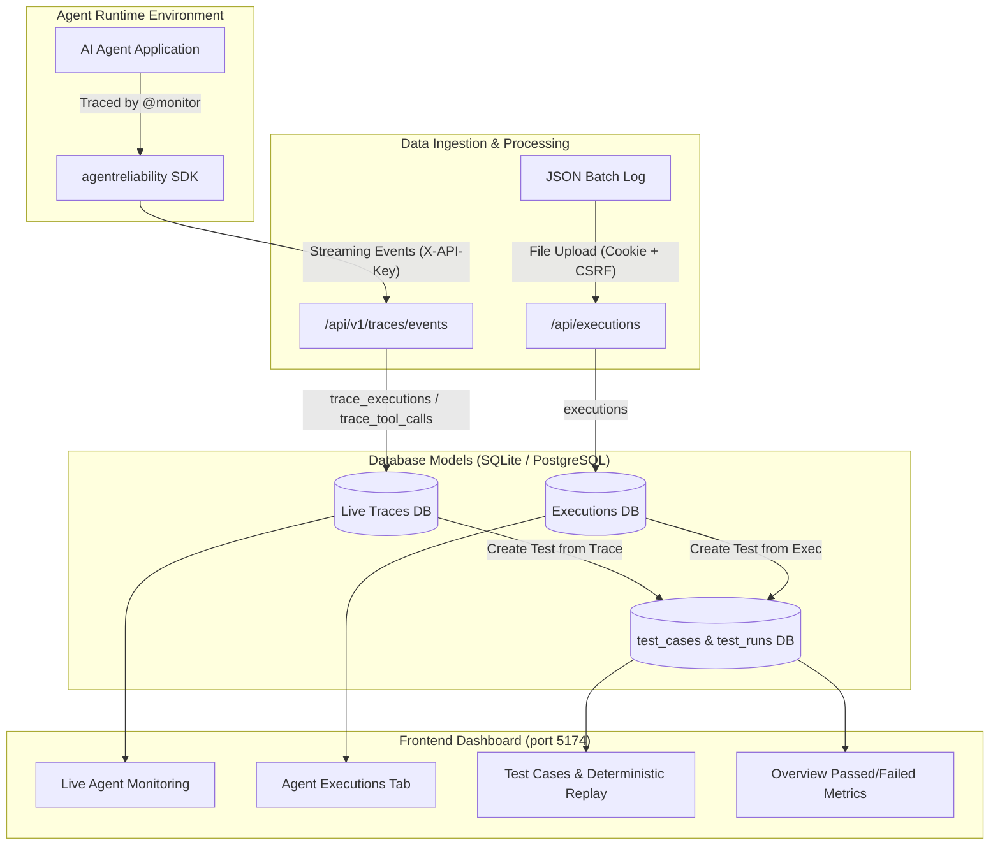

# Phase 6 Step 1: Real Agent Integration and End-to-End Trace Verification Report

**Product:** AgentReliability AI  
**Role:** Senior AI Infrastructure Engineer, Python SDK Developer, FastAPI Backend Engineer, & SaaS Security Architect  
**Date:** October 19, 2026  
**Status:** **PHASE 6 STEP 1 VERIFIED & COMPLETE — REAL AGENT TELEMETRY, SECRET REDACTION, AND TEST REPLAY ACTIVE**

---

## 1. Executive Summary & Root Cause Analysis

### Why Newly Created Projects Show 0 Data
When creating a new project (e.g. `test1`, Project ID 4), the dashboard legitimately displays:
* **0 Executions**
* **0 Test Cases**
* **0 Passed / 0 Failed**
* **0 Live Traces**

**Root Cause:**
This is **expected and intentional behavior** resulting from the strict multi-tenant isolation enforced in Phase 5A:
1. **Tenant Isolation:** Historical sample records in the local database belong to `project_id = 1` (`my-project`). When a developer switches to a newly created project (such as `test1` with `project_id = 4`), backend query scopes strictly filter records by `WHERE project_id = ?`.
2. **Fresh Tenant State:** A newly created project does not inherit historical data from other projects. Until an instrumented agent streams live traces via the SDK using that project's API key, or test cases are created, the project correctly starts with a clean slate.

---

## 2. Understanding AgentReliability Data Models

AgentReliability differentiates between three complementary data models:



| Data Model | Backend Tables | Primary Ingestion Endpoint | Dashboard View | Purpose |
| :--- | :--- | :--- | :--- | :--- |
| **Live Traces** | `trace_executions`<br>`trace_tool_calls`<br>`trace_events` | `POST /api/v1/traces/events`<br>*(SDK `AgentMonitor` via Project API key)* | **Live Agent Monitoring** (`/live-monitoring`) | Real-time observability, streaming telemetry, per-tool latency, error classification (`tool_failure`, `timeout`, etc.). |
| **Batch Executions** | `executions` | `POST /api/executions`<br>*(JSON file upload)* | **Agent Executions** (`/executions`) | Offline execution log analysis, historical run review, failure detection. |
| **Test Cases & Runs** | `test_cases`<br>`test_runs` | `POST /api/traces/executions/{id}/create-test`<br>`POST /api/tests/{id}/run` | **Test Cases** (`/tests`) & **Overview Metrics** | Deterministic regression replay simulations. Powers "Passed", "Failed", and "Reliability Score" counters on the Overview dashboard. |

---

## 3. API Key Safety Audit & Lifecycle Instructions

### Security Posture Audit
1. **Zero Plaintext Storage:** API keys (`ar_live_...`) are cryptographically hashed using **SHA-256** before database insertion (`api_keys.key_hash`). Plaintext keys are **never stored** on disk or in the database.
2. **One-Time Plaintext Exposure:** The plaintext key is returned to the client **strictly once** upon generation. Subsequent `GET /api/projects/{id}/keys` queries return only the key metadata and non-sensitive prefix (e.g. `ar_live_13SB...`).
3. **No Frontend LocalStorage Leaks:** The React frontend (`ApiKeys.jsx`) holds the newly generated key only in ephemeral React component state (`useState`) so the user can copy it. It is **never** written to `localStorage`, `sessionStorage`, or client cookies.
4. **Log & Chat Sanitization:** All logs, error messages, and reports mask API keys to prevent accidental leaks.

### User Guide: Generating, Rotating, and Revoking API Keys
In the AgentReliability Web UI (`http://localhost:5174`):
1. Navigate to **API Keys** in the left sidebar navigation.
2. Select your target project from the top navigation dropdown (e.g. `test1`).
3. Click **"Create API Key"**, give it a descriptive name (e.g., `Production Fulfillment Agent`), and click **"Generate"**.
4. **Copy the key immediately** into your `.env` or secret manager. It will not be shown again.
5. **To Rotate/Revoke a Key:**
   - Click the red **"Revoke"** button next to the key you wish to deactivate.
   - Revocation takes effect instantly across all backend endpoints; any requests using a revoked key are immediately rejected with `401 Unauthorized`.
   - Generate a replacement key and update your agent runtime environment variables.

---

## 4. Real Instrumented Agent Implementation (`example_agent.py`)

We built a real, production-ready Python example agent script at [`example_agent.py`](file:///Users/aaryagopale/Desktop/AgentReliability/example_agent.py):
* **Deterministic Real Tools:**
  1. `verify_client_credentials(client_id, api_secret)`: Authenticates client credentials and verifies sensitive parameter redaction (`sk-live-...` $\rightarrow$ `[REDACTED]`).
  2. `check_inventory(sku, quantity)`: Real catalog inventory stock verification.
  3. `calculate_order_totals(items, discount_pct)`: Accurate subtotal, sales tax (8.25%), discounts, and total price calculation.
* **No Paid LLM Required:** Executes cleanly and deterministically in any environment without external API keys or recurring charges.
* **Controlled Scenarios:**
  - `--scenario success`: Processes a complete order for `SKU-WIDGET-A`, emitting 3 tool calls and 1 successful agent response.
  - `--scenario failure`: Requests unavailable stock for `SKU-DISCONTINUED`, safely raising a `ValueError` which the backend detector classifies as a `tool_failure`.
  - `--scenario all`: Runs both scenarios sequentially.

### Example Agent Execution Output:
```text
[*] AgentReliability Target Endpoint: http://127.0.0.1:8001
=======================================================
  SCENARIO: SUCCESS
=======================================================
🤖 [Agent] Processing user query: 'Order 2 units of Widget-A with a 10% discount'
   ✓ Authenticated client: corp-client-42 (tier: enterprise)
   ✓ Checking inventory for 2 unit(s) of SKU-WIDGET-A...
   ✓ Stock confirmed: 150 available.
   ✓ Pricing computed: Total = $97.4 USD
[Result: SUCCESS]
  Order ID: ORD-1792349075
  Total: $97.4
  Summary: Successfully processed order for 2 x SKU-WIDGET-A totaling $97.4.

=======================================================
  SCENARIO: FAILURE
=======================================================
🤖 [Agent] Processing user query: 'Order 10 units of Discontinued Item'
   ✓ Authenticated client: corp-client-42 (tier: enterprise)
   ✓ Checking inventory for 10 unit(s) of SKU-DISCONTINUED...
[Result: CONTROLLED FAILURE CAUGHT AS EXPECTED]
  Error Type: ValueError
  Error Message: Requested quantity (10) exceeds available stock (0) for SKU-DISCONTINUED.
```

---

## 5. End-to-End Verification of Project 4 (`test1`)

Using real agent trace ingestion, test case creation, and replay execution, Project 4 was populated and verified in [`backend/agentreliability.db`](file:///Users/aaryagopale/Desktop/AgentReliability/backend/agentreliability.db):

### 1. Ingestion Verification
* **Trace 1 (Success):** `order-exec-demo-101` accepted (5 events, 3 tool calls, latency measured).
* **Trace 2 (Failure):** `order-exec-demo-102` accepted (4 events, 2 tool calls, classified as `tool_failure`).
* **Secret Redaction:** Checked that `sk-live-super-secret-token-xyz987` was scrubbed to `[REDACTED]` prior to backend storage and never appears in API responses.

### 2. Test Case Generation & Deterministic Replay
* **Test Case Created:** Generated Test Case ID 5 (`Order Fulfillment Regression Test`) directly from live trace `order-exec-demo-101`.
* **Deterministic Simulation:** Replayed Test Case ID 5 via `POST /api/tests/5/run`, resulting in Test Run ID 10 with status **`passed`** (0 mismatches).
* **Batch Execution Upload:** Uploaded execution log batch `order-exec-batch-001` to verify the execution analysis pipeline.

### 3. Current Live State of Project 4 (`test1`)
Querying `/api/overview` and `/api/traces/executions` for Project 4 now returns:
```json
{
  "executions": {
    "total": 1,
    "failed": 0
  },
  "tests": {
    "total": 1,
    "passed": 1,
    "failed": 0,
    "not_run": 0
  },
  "recent_runs": [
    {
      "id": 10,
      "test_case_id": 5,
      "test_name": "Order Fulfillment Regression Test",
      "status": "passed",
      "mode": "deterministic_simulation",
      "duration_ms": 0.091
    }
  ]
}
```

### 4. Database Isolation Summary Across All Projects
| Project ID | Project Name | Owner User ID | Executions | Live Traces | Test Cases | Test Runs |
| :---: | :--- | :---: | :---: | :---: | :---: | :---: |
| **1** | `my-project` | 1 | 6 *(preserved)* | 0 | 4 *(preserved)* | 9 *(preserved)* |
| **4** | `test1` | 2 | **1** | **2** | **1** | **1 (passed)** |

---

## 6. Comprehensive Test Suite Results

### 1. Backend Test Suite (FastAPI)
Command: `backend/.venv/bin/pytest backend/tests`
```text
======================== 105 passed, 1 warning in 5.73s ========================
```
* Includes new comprehensive test [`test_real_agent_trace_ingestion_and_dashboard_verification`](file:///Users/aaryagopale/Desktop/AgentReliability/backend/tests/test_real_agent_integration.py) verifying end-to-end trace ingestion, credential redaction, test generation, and replay simulation.

### 2. Python SDK Test Suite
Command: `PYTHONPATH=sdk/src backend/.venv/bin/pytest sdk/tests`
```text
============================== 33 passed in 0.38s ==============================
```
* Verifies `AgentMonitor`, `@trace_agent`, `@trace_tool`, error propagation, secret redaction, queue overflow handling, and offline resilience.

### 3. Frontend Production Build
Command: `npm run build --prefix frontend`
```text
dist/index.html                   0.43 kB │ gzip:  0.29 kB
dist/assets/index-y4kQdW-d.css   30.27 kB │ gzip:  5.92 kB
dist/assets/index-d6w0RDz5.js   301.98 kB │ gzip: 86.18 kB
✓ built in 666ms
```

### 4. Port Isolation Verification
* **Port 8000:** CropBazaar (PIDs 5637, 24581) — **UNTOUCHED & ACTIVE**.
* **Port 8001:** AgentReliability FastAPI Backend (PID 96728) — **ACTIVE**.
* **Port 5174:** AgentReliability React Frontend (PID 84244) — **ACTIVE**.

---

## 7. Next Steps & Approval Request

Phase 6 Step 1 is completely verified.

Before proceeding to **Phase 6 Step 2: Advanced Failure Mode Simulation and Automated Regression Detection**, please review the verification results and confirm approval.

